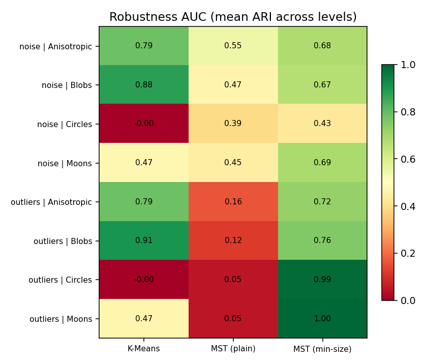
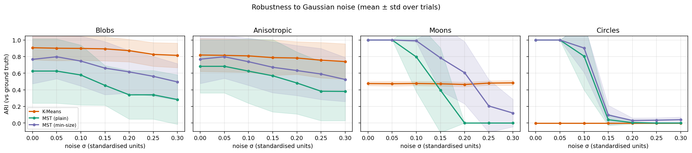
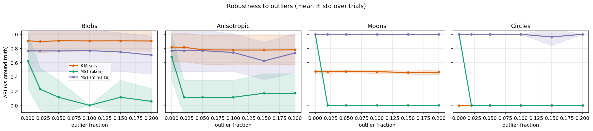
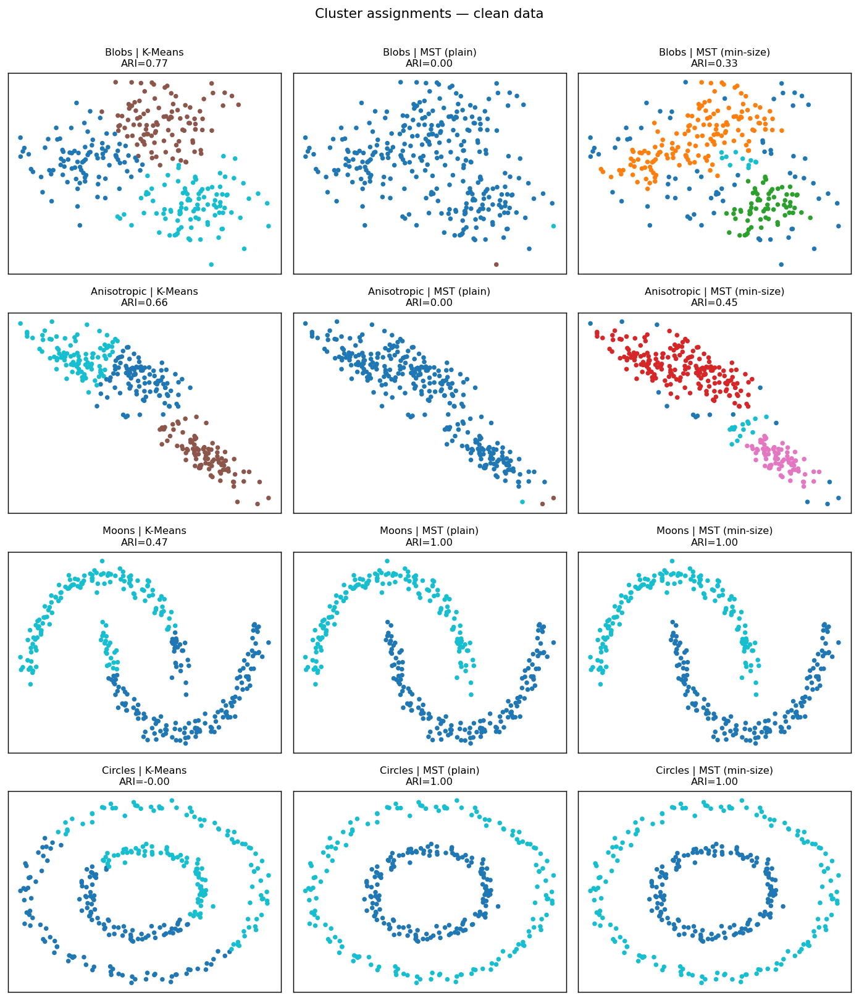
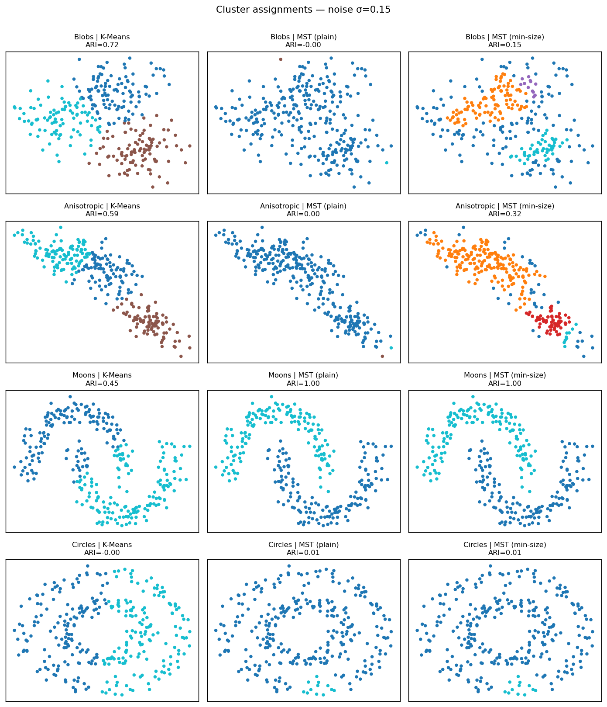
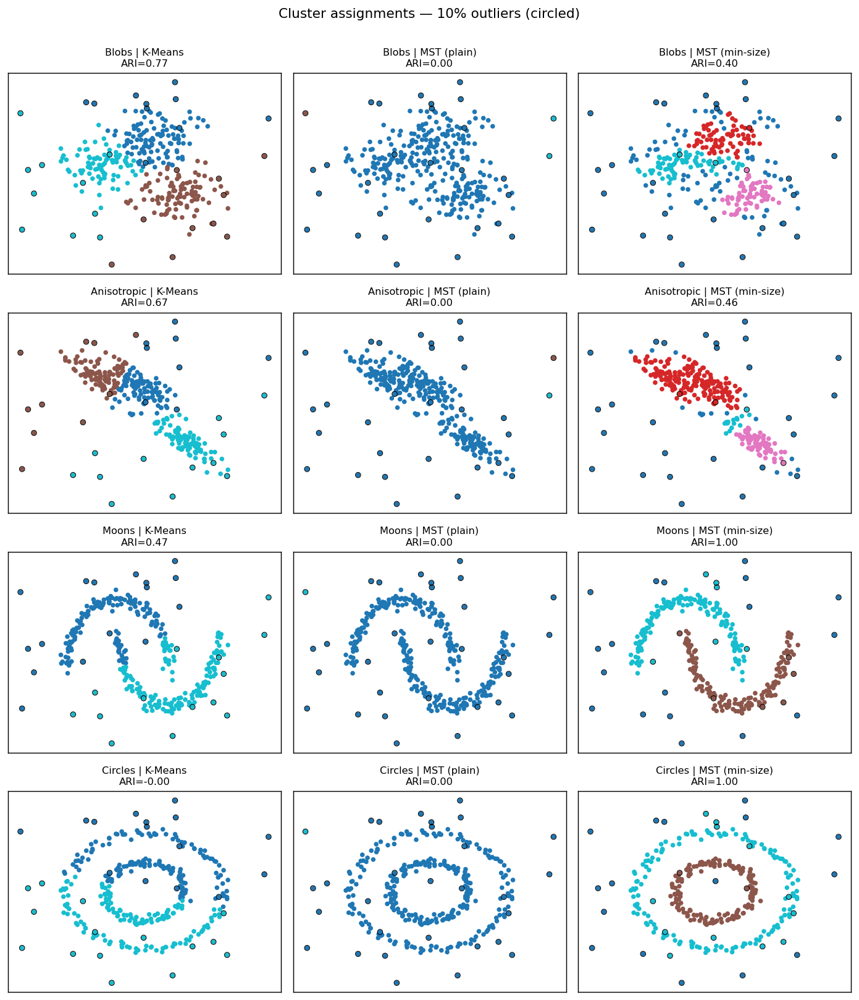
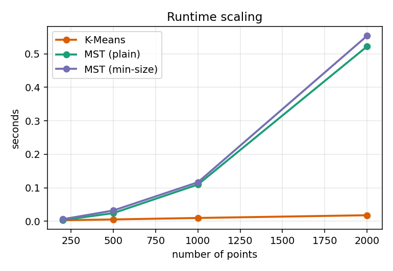

# MST vs K-Means: Robustness Analysis

> A quantitative comparison of **MST-based clustering** (Zahn-style edge cutting) vs **K-Means** under noise, outliers, and non-linear data distributions.

---

## 📌 Overview

This project benchmarks three clustering algorithms across four synthetic datasets to evaluate **robustness**, **accuracy**, and **runtime scalability**:

| Algorithm | Description |
|---|---|
| **K-Means** | Standard centroid-based clustering (`sklearn`, n_init=10) |
| **MST (plain)** | Build MST, cut the k−1 heaviest edges (Zahn's method) |
| **MST (min-size)** | Cut heaviest edges; ignore tiny components as noise (label = −1) |

---

## 📂 Project Structure

```
mst_vs_kmeans/
│
├── mst_vs_kmeans.py          # Main script (all experiments)
├── requirements.txt          # Python dependencies
├── README.md
│
└── results/
    ├── noise_robustness.png          # ARI vs noise level
    ├── outlier_robustness.png        # ARI vs outlier fraction
    ├── clusters_clean.png            # Cluster assignments (clean)
    ├── clusters_noise.png            # Cluster assignments (noisy)
    ├── clusters_outliers.png         # Cluster assignments (with outliers)
    ├── robustness_heatmap.png        # Robustness AUC heatmap
    ├── runtime.png                   # Runtime scaling
    ├── raw_results.csv               # Full trial-level results
    ├── robustness_summary.csv        # Per-algo robustness metrics
    ├── nonlinear_clean_results.csv   # Clean / non-linear results
    └── runtime.csv                   # Runtime data
```

---

## 🧪 Datasets

| Dataset | Shape | Clusters |
|---|---|---|
| **Blobs** | Isotropic Gaussians | 3 |
| **Anisotropic** | Stretched/rotated Gaussians | 3 |
| **Moons** | Two interleaving half-circles | 2 |
| **Circles** | Concentric circles | 2 |

---

## 📊 Results

### Non-linear / Clean Performance

| Dataset | Algorithm | ARI | NMI |
|---|---|---|---|
| Circles | MST (plain / min-size) | **1.000** | **1.000** |
| Circles | K-Means | -0.003 | 0.000 ❌ |
| Moons | MST (plain / min-size) | **1.000** | **1.000** |
| Moons | K-Means | 0.476 | 0.379 |
| Blobs | K-Means | **0.907** | **0.900** |
| Anisotropic | K-Means | **0.820** | **0.827** |

### Robustness AUC (higher = better)

| Experiment | K-Means | MST (plain) | MST (min-size) |
|---|---|---|---|
| **Noise** | 0.534 | 0.463 | **0.618** ✅ |
| **Outliers** | 0.540 | 0.096 ❌ | **0.867** ✅ |

---

## 📈 Visualizations

### Robustness Heatmap


### Noise Robustness


### Outlier Robustness


### Cluster Assignments (Clean)


### Cluster Assignments (Noise σ=0.15)


### Cluster Assignments (10% Outliers)


### Runtime Scaling


---

## 🔑 Key Findings

- **MST excels on non-convex shapes** (Circles, Moons) where K-Means completely fails
- **MST (plain) is fragile to outliers** — a single noise point can chain-link two clusters
- **MST (min-size) fixes the outlier problem** by treating tiny components as noise — beats K-Means on outlier robustness
- **K-Means is superior on blob-like data** with Gaussian noise

---

## 🚀 How to Run

```bash
# Install dependencies
pip install -r requirements.txt

# Full run (~1–2 minutes)
python mst_vs_kmeans.py

# Quick run (fewer trials)
python mst_vs_kmeans.py --quick

# Custom dataset size
python mst_vs_kmeans.py --n 500
```

---

## 📦 Requirements

```
numpy
scipy
scikit-learn
pandas
matplotlib
```

---

## 📐 Metrics Used

| Metric | Description |
|---|---|
| **ARI** | Adjusted Rand Index — agreement with ground truth |
| **NMI** | Normalized Mutual Information |
| **Silhouette** | Internal cluster quality (no ground truth needed) |
| **Robustness AUC** | Mean ARI across all perturbation levels |
| **Stability Index** | ARI between clean vs perturbed labels |
| **Retention Ratio** | ARI(perturbed) / ARI(clean) |

---

## 👨‍💻 Author

**Biswa** — Pattern Mining / Unsupervised Learning Project
